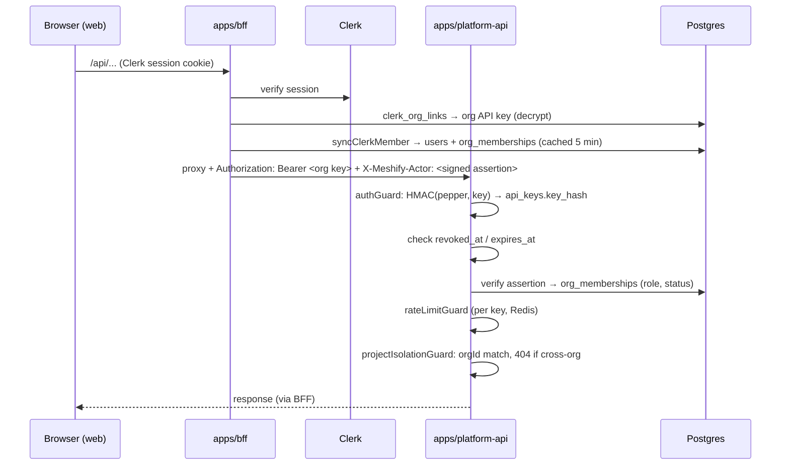
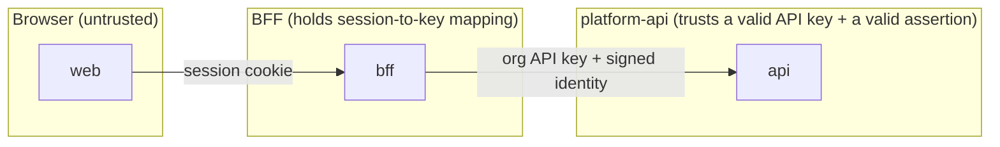

# Authentication & Authorization

> Two boundaries: the **BFF** turns a Clerk session into an org API key plus a
> signed statement of *who* is acting; the **platform-api** authenticates the
> key, resolves that person's role from its own tables, and isolates every
> request to the caller's org and project. The browser never holds a platform
> credential, and never sees or sends a role.

## Overview

- **AuthN (who):** Clerk session (browser ↔ BFF) → HMAC-hashed org API key + signed identity assertion (BFF ↔ platform-api).
- **Identity:** Clerk authenticates; Meshify owns people and roles. The BFF mirrors the signed-in Clerk user into `users` + `org_memberships` just in time, and platform-api reads the role from `org_memberships` on every request, so a role change or a removal takes effect immediately.
- **AuthZ (what):** `projectIsolationGuard` scopes every project route to the key's `orgId`; cross-org access is `404`, not `403`. Org-admin actions require the Meshify org role `owner` or `admin`. Per-project roles and capability checks are the next milestones (see the [roadmap](../product/ai-pm-roadmap.md), Phase 1).
- **Defense in depth:** per-key rate limiting, audit logging of mutations, and credential redaction in logs.

## Architecture

### End-to-end flow

### Trust boundaries

### Principals

| Key `kind` | Assertion | Principal | Authority |
| --- | --- | --- | --- |
| `bff` | valid, for this org | **user** (`req.auth.userId`, `req.auth.orgRole`) | the person's `org_memberships` row; no active membership is `403 not_a_member` |
| `bff` | missing / unverifiable | legacy | `permissive`: the legacy `X-Meshify-Org-Role` header, with a warning log. `required`: `401` |
| `service` | never read | **service** | the key's scopes. A machine credential cannot impersonate a person |

## Implementation

### Keys are never stored in clear
`key_hash = HMAC-SHA256(PLATFORM_API_KEY_PEPPER, plaintext)`. A DB leak alone
cannot verify or reconstruct a key without the pepper. Lookup is a single
indexed probe (`api_keys.key_hash` is `UNIQUE`).
See `packages/data-access/src/api-keys/api-key.entity.ts`,
`apps/platform-api/src/modules/security/application/authenticate.usecase.ts`.

### Uniform failures (no enumeration)
`AuthenticateApiKeyUseCase` returns the **same** error for missing, malformed,
unknown, revoked, and expired keys, so a caller can't probe which keys exist.

### The identity assertion
`X-Meshify-Actor: v1.<payload>.<hmac-sha256>`, payload `{ sub: users.id, org, iat, exp = iat + 60s }`,
signed with `BFF_ASSERTION_SECRET` (identical on both services). It carries
identity only, never a role. It is bound to one org, so it cannot be replayed
with another org's key, and the BFF overwrites or strips the header on every
route, so a browser can never supply one. HMAC rather than a JWT: the verifier
is the party being protected. Codec: `packages/shared/src/actor-assertion.ts`.

`IDENTITY_ASSERTION_MODE=permissive` is the rollout default (platform-api
deploys before the BFF, and a secret mismatch must not take sign-in down). Flip
to `required` once both services are live; both then refuse to boot without the
secret.

### Just-in-time member sync
`syncClerkMember` (`packages/data-access/src/identity/sync-clerk-member.ts`)
upserts the `users` row and the `org_memberships` row in one transaction that
locks the organization row, so concurrent first requests cannot both elect
themselves owner. Clerk's role only **seeds** a membership (no owner yet and
Clerk admin → `owner`; Clerk admin → `admin`; otherwise `member`); after that the
Meshify role is authoritative. A `removed` membership is only reactivated after
Clerk's membership API (not the possibly stale session claim) confirms it.
The BFF caches only the person's id (`MemberResolver`), never the role.

### Org secrets are encrypted at rest
The BFF's org API key is stored encrypted (`ORG_KEY_ENCRYPTION_KEY`) and
decrypted only when proxying — see `packages/data-access/src/provisioning/secret-encryption.ts`.

### Isolation
`projectIsolationGuard(getProject)` loads the project, asserts
`project.orgId === req.auth.orgId`, and returns `404` on mismatch. Every project
route uses `req.project.id` — never a body/query `projectId`.
See `apps/platform-api/src/modules/projects/interface/project-isolation.guard.ts`.

### Logging safety
Credentials never reach logs: the shared logger redacts
`req.headers.authorization`, `req.headers.cookie`, and `res.headers["set-cookie"]`
(`packages/shared/src/logger.ts`).

## Best Practices
- Read the tenant from `req.auth.orgId` / `req.project`, never the request body.
- Read the person from `req.auth.userId` (a `users.id`); it is absent for service keys, so attribution columns are nullable.
- Add mutating routes **after** `auditLogMiddleware` so they're recorded.
- Rotate the pepper/encryption keys via env, never in code.

## Common Mistakes
- Returning `403` for cross-org access (leaks existence) — return `404` via the isolation guard.
- Logging raw headers in a custom middleware (bypasses redaction).
- Trusting a `projectId` from the client instead of the resolved `req.project`.

## Troubleshooting
| Symptom | Cause | Fix |
| --- | --- | --- |
| 401 for everyone | Wrong/absent `PLATFORM_API_KEY_PEPPER` | Align pepper across issuer + API |
| 401 for one org | Key revoked/expired, or missing `clerk_org_links` row | Re-provision the org |
| 404 for a real project | Cross-org access | Use the owning org's key |
| `identity assertion rejected` warnings, `reason: bad_signature` | `BFF_ASSERTION_SECRET` differs between the BFF and platform-api | Set the same value on both |
| `403 not_a_member` | No active `org_memberships` row (removed in Clerk or suspended) | Re-add the person in Clerk; the BFF reactivates on their next request |
| `GET /v1/me` says `principalKind: service` for a browser session | No secret configured, or the assertion was rejected (permissive fallback) | Check the platform-api warning log |

## Examples
Issue a key: `packages/data-access/src/scripts/issue-api-key.ts`.
Guard tests: `apps/platform-api/src/modules/security/**/*.test.ts`.

## References
- `apps/platform-api/src/modules/security/**`
- `apps/bff/src/modules/auth/**`, `apps/bff/src/modules/proxy/platform-proxy.ts`
- `packages/data-access/src/{api-keys,provisioning,identity}/**`, migration `0019_identity.sql`
- `packages/shared/src/actor-assertion.ts`

## Related
- [Backend](../architecture/backend.md) · [Environment Variables](../reference/environment-variables.md)

## Next
- [Queues & Workers](queues-and-workers.md).

---
[← Handbook](../README.md)
