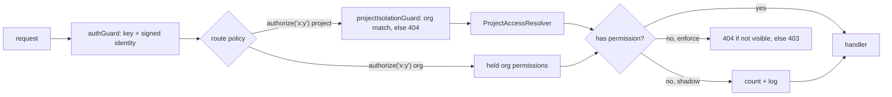

# Roles & Permissions (RBAC)

> Authentication answers *who*; this page is about *what they may do*. Every
> route declares one permission, permissions come from roles, and roles live in
> Postgres. Clerk is not consulted for any of it.

## Overview

- **Permissions** are the unit of authorization (`documents:write`, `memory:confirm`). Handlers never ask "is this an admin"; they declare a permission.
- **Org roles** (`owner`, `admin`, `member`) live on `org_memberships`. **Project roles** (`pmo`, `developer`, `ba`, `viewer`) live on `project_memberships`. One person can be a BA on one project and a Developer on another.
- The catalog and the role matrix are **code** (`packages/authz`), shared by platform-api and the web app, so the two cannot disagree. Adding a built-in project role needs no migration.
- A route that declares nothing **fails the boot**. That is deliberate: the original gap was not a wrong check, it was an absent one.
- Rollout is **shadow first**: decisions are computed and denials only counted, until the counter is quiet.

## Architecture



### Principals

| Principal | When | Authority |
| --- | --- | --- |
| `user` | BFF key + verified identity assertion | org role's permissions, plus the project role in each project |
| `service` | a `service` API key | its scopes, expanded to permissions, in every project of the org. Never inherits a project's default member role |
| `legacy_user` | BFF key with no verified identity (previous BFF during a deploy, or the permissive fallback) | what the forwarded admin/member flag always meant. Gone once `IDENTITY_ASSERTION_MODE=required` |

### Effective project permissions

`effective = (project-scoped permissions held org-wide) + (project role's permissions)`

The project role is the explicit `project_memberships` row, else the project's
`default_member_role_key`, else none. **Visibility is simply holding
`project:read`.** Owners and admins hold every project permission org-wide,
which is why they see every project with no special case anywhere.

`default_member_role_key` is the no-lockout valve: every project that existed
before roles was open to its whole org, so migration 0019 set it to
`developer`. New projects default to `NULL` (private) and their creator becomes
`pmo` in the same SQL statement as the project insert.

### The role matrix

The exact grants are pinned by inline snapshots in
`packages/authz/src/authz.test.ts`; change the matrix and that diff is what gets
reviewed. In short:

| | PMO | Developer | BA | Viewer |
| --- | --- | --- | --- | --- |
| Read everything in the project, chat | x | x | x | x |
| Add documents, propose memory, work items | x | x | x | |
| Connect / sync repositories | x | x | | |
| Sync connectors | x | x | x | |
| Delete documents, edit + confirm memory, assign work, generate digests | x | | x | |
| Members, settings, connect/disconnect sources, delete, memory admin | x | | | |

Org: `owner` = everything; `admin` = everything except `org:delete`,
`members:manage_owners`, `billing:manage`; `member` = read the org, create
projects, and nothing inside a project except through a project role.

## Implementation

### Declaring a route

Every endpoint registered through `createRouter()` must carry exactly one
policy handler (`apps/platform-api/src/http/route-policy.ts`):

```ts
const { authorize } = deps.authz;

router.post('/v1/projects/:projectId/documents', authorize('documents:write'), upload.single('file'), handler);
router.get('/v1/me', authenticatedOnly('describes only the caller'), handler);
router.get('/health/live', publicRoute('liveness probe; reveals nothing'), handler);
```

- `authorize(permission)` must be the **first** handler - before multer or any body parser - so an unauthorized upload is refused before it is buffered.
- For a project-scoped permission it replaces `projectIsolationGuard`: it loads `:projectId`, 404s across orgs, sets `req.project`, then sets `req.projectAccess` (`role`, `source`, `permissions`).
- A project named in a request **body**, or reached through another resource (a job id), has no route parameter to guard: use `deps.authz.checkProjectById(req, projectId, permission)` and answer `hidden` with `respondProjectNotFound` and `forbidden` with `forbiddenBody`.

### Three guards against an undeclared route

1. `createRouter()` throws `UndeclaredRoutePolicyError` at registration, so the process does not boot.
2. `apps/platform-api/src/route-permissions.manifest.test.ts` snapshots `METHOD path -> policy` for every controller, and fails if `main.ts` mounts a controller the manifest does not list.
3. ESLint forbids constructing a bare Express `Router` anywhere in platform-api outside `http/router.ts`.

### Responses

| Situation | Response |
| --- | --- |
| Project not visible to the caller | `404`, byte-identical to a project that does not exist |
| Visible, permission missing | `403 { error, code: "forbidden", permission }` |
| No active org membership | `403 { code: "not_a_member" }` (from `authGuard`) |

### API key scopes

`expandScopes` (`packages/authz/src/scopes.ts`): an exact permission, `resource:*`,
`*`, and the legacy `admin` (= `*`), `read` (read tier), `write` (read + write
tiers). A typo expands to nothing. An empty list means *nothing* in the catalog;
until the cutover migration rewrites today's unscoped service keys to
`{admin}`, `principal.ts` reads an empty list as unrestricted, as it always was.

## Rollout

| Step | Setting | Meaning |
| --- | --- | --- |
| 1 | `RBAC_ENFORCEMENT=shadow` (default) | Denials increment `meshify_rbac_denials_total{mode="shadow",permission,route,outcome,principal}` and log `rbac shadow denial`. The request continues to the pre-existing checks |
| 2 | Watch the counter | Every shadow denial is a request that *will* break. Fix the matrix or the membership, not the counter |
| 3 | `RBAC_ENFORCEMENT=enforce` | Denials become 404 / 403 |

## Best Practices
- Name the permission for the **action**, not the role (`memory:confirm`, never `pmo_only`).
- Add a permission to the catalog and to a role in the same change as the route that checks it.
- Hide UI by permission, never by role name, and treat the API as the authority: a hidden button is a courtesy.

## Common Mistakes
- Putting `authorize()` after `upload.single()`: the file is buffered before the caller is refused.
- Returning 403 for a project the caller cannot see: it confirms the project exists.
- Granting a service key access by giving a project a default member role: that role is a grant to the org's *people*.
- Reading `req.auth.isOrgAdmin` in new code. It is the legacy flag and is removed at cutover.

## Troubleshooting
| Symptom | Cause | Fix |
| --- | --- | --- |
| Process exits at boot with `declares no access policy` | A new route has no policy handler | Add `authorize(...)`, `authenticatedOnly(...)` or `publicRoute(...)` |
| Manifest test fails after adding a controller | `main.ts` mounts a controller the manifest does not list | Add it to `CONTROLLERS` in the manifest test and review the new lines |
| `project membership names a role the catalog does not define` | A `role_key` with no entry in `roles.ts` (rolled-back release, removed role) | It grants nothing by design; restore the role or change the membership |
| Member gets 404 on a project they created | Created through a service key or the legacy path, so no creator membership exists | Add them as `pmo`, or set the project's default member role |

## References
- `packages/authz/src/**`
- `apps/platform-api/src/http/{router,route-policy}.ts`
- `apps/platform-api/src/modules/security/authorization/{principal,project-access,authorizer}.ts`
- `packages/data-access/migrations/0019_identity.sql`

## Related
- [Authentication & Authorization](auth.md) · [Roadmap](../product/ai-pm-roadmap.md) · [Data Model](../architecture/data-model.md)

---
[← Handbook](../README.md)
