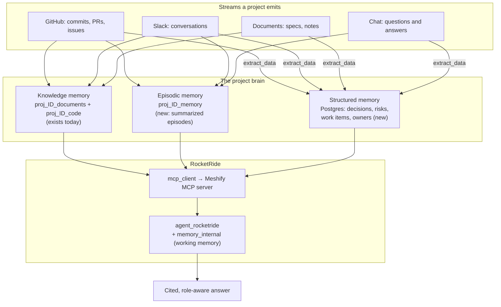

# Meshify as an AI Project Management Platform

> Meshify today answers questions about a codebase with citations. The product
> we want answers questions about a *project* — its decisions, its risks, who
> owns what, what changed this week — and remembers the answers. This document
> is the path from one to the other, written against the code as it actually
> exists on `main` today, and the RocketRide engine as its vendored docs
> actually describe it.

## 1. Where we actually are

It is worth being precise about the starting line, because the gap between the
README and the code is where roadmaps usually go wrong.

**What is genuinely built and working.** The provider platform is the strongest
part of the system and is not, as `architecture/provider-platform/current-state.md`
still claims, a design document. GitHub and Slack ship as real `Provider`
implementations with OAuth, signature-verified webhooks, incremental sync, health
checks and BYOA, registered in both composition roots. The credential vault
(`packages/providers/src/vault/credential-vault.ts`) is real AES-256-GCM storage
with scoped handles. The `ConnectorEngine` owns content-hash change detection and
purge-before-reingest. Document upload runs end to end from the SPA through the
BFF to S3, through BullMQ, into per-project Qdrant collections, with a SHA-256
integrity gate on the way out of storage. Every project already gets two
physically separate Qdrant collections, provisioned at creation and torn down
before the Postgres row, which makes tenant isolation structural rather than a
query filter someone can forget.

**What is thinner than it looks.** Chat is a single question-and-answer call.
`AskQuestionUseCase` loads the last ten messages
(`apps/platform-api/src/modules/chat/application/ask-question.usecase.ts`,
`HISTORY_TURNS = 10`), retrieves eight chunks, and sends a static four-line
instruction block. There is no rolling summary, so a long thread silently loses
its head. Conversations have no author — `chats.user_id` was made nullable by
migration `0004` "until the auth step populates it," and that follow-up never
happened, so every member of an org sees every other member's threads with no
attribution. Confidence is computed per turn and never persisted. `modelUsed`
and `tokenUsage` are columns and UI chips that are always null, because
`RocketRideRagService.ask` returns only `{ answer, latencyMs }`.

**What does not exist at all.** There is no memory. I grepped the whole
repository for it; every hit is `memoizeForMs`, "in-memory fakes", or marketing
copy. Chat messages are never embedded back into Qdrant, so the product cannot
recall its own conversations. There is no `/search` endpoint despite the README
and `ai/rag-and-ingestion.md` both describing semantic search — `hybridRank` and
`mergeAndRank` are reachable only from chat. GitHub issues and pull requests are
not ingested; a grep for `pull_request|issues|issue_comment` returns zero
non-test hits. Ingestion is repository *file content* only.

**The one structural constraint to design around.** `'documents' | 'code'` is
hardwired as a two-valued union across the entire write path: `IngestTarget`,
`KnowledgeWriter.embed`, `ConnectorEngine.flush`'s
`for (const target of ['documents', 'code'] as const)`,
`ProjectKnowledgeWriter.deleteBySourceRefs`, `qdrantCollectionName`, the two
collection columns on `projects`, and the two per-project ingest pipeline GUIDs.
Everything in Phase 1 below depends on widening that union to three.

## 2. The product thesis

An AI project management tool is not a chatbot bolted to a Gantt chart. The
useful version is a **project brain**: one place that has watched everything that
happened to a project and can be asked about it in plain language.

The distinction that matters is between *retrieval* and *memory*. Retrieval
answers "what does the code say about authentication" by finding chunks.
Memory answers "why did we choose Clerk over Auth0" — a question whose answer
was never written in a document, only decided in a Slack thread in March and
half-mentioned in a PR description. Retrieval is a function of the corpus.
Memory is a function of time.

Meshify has retrieval. The roadmap is memory.

Three properties define the target:

**Every project remembers.** A project accumulates decisions, risks, owners,
commitments and their outcomes. These are extracted from the streams the project
already emits — Slack conversations, GitHub activity, uploaded documents, and
the chat itself — and stored as durable, queryable facts, not just as vectors.

**The chat is the product surface.** Not a sidebar. Asking "where are we on the
payments migration" should produce a synthesized answer drawing on the last two
weeks of commits, the design doc, the Slack thread where scope changed, and the
three open risks — with citations to each.

**The answer depends on who is asking.** A manager asking for status wants
outcomes, slippage and blockers. A developer asking the same question wants the
open PRs and the failing checks. Same memory, different synthesis and different
tool access. This is where RBAC stops being an access-control chore and becomes
a product feature.

## 3. The constraint that shapes everything: RocketRide has no project memory

Since every AI capability must run through RocketRide, I read the vendored docs
and component schemas before designing around them. The finding is important
enough to state plainly, because it is easy to assume otherwise from the
component names:

**RocketRide does not provide per-project long-term memory.** There are four
memory-shaped components and none of them is a candidate:

`memory_internal` is a run-scoped scratchpad — put, get, peek, list, clear —
that exists so an agent can hold intermediate results across planning waves
without bloating context. It has exactly one config field and dies with the run.
It is also *mandatory*: `agent_rocketride` declares `invoke.memory` with
`min: 1, max: 1`, so every wave-planning agent must have one wired. We will use
it, but it is a token-budget device, not memory.

`memory_persistent` sounds right and is not. It is Redis-backed session history
with `max_history` defaulting to 100 and `auto_summarize` defaulting to true, so
older facts degrade lossily rather than persist. It has no semantic retrieval —
it is keyed storage, not vector search. Critically, **its schema exposes no
session-key, namespace or project-id field at all**, so there is no declarative
way to scope it to a project. Its backend also defaults to `"memory"`, meaning
a deployment that forgets to set `redis` gets nothing persistent whatsoever.

`tool_mem0` and `tool_xtrace_memory` *are* real long-term semantic memory with
per-call scoping, but both are external hosted SaaS. Adopting either means
project data leaves our infrastructure, we pay an uncontrolled per-store LLM
extraction pass, and recall is capped at 100 rows. Both are `classType: ["tool"]`,
so neither satisfies an agent's memory port anyway. (If we ever do buy rather
than build, xTrace is the better fit — its `group_ids` and `agent_id` scopes are
reliably stored, whereas Mem0's docs warn that its non-`user_id` scopes can
silently return empty recalls.)

**Decision: we build per-project memory ourselves on Postgres and Qdrant, and
expose it to RocketRide through an MCP server.** We already run all three
datastores. The MCP seam is RocketRide-native — `mcp_client` connects over
`streamable-http` and namespaces the server's tools as `<serverName>.<toolName>` —
and it lets us pass a project id per call with our own scoping semantics, which
is exactly the axis `memory_persistent` cannot express.

Two further engine constraints shape the design and are worth recording here so
nobody rediscovers them the hard way:

**`project_id` cannot be templated.** It is read before environment substitution
runs, so a single `.pipe` file cannot be parameterized per customer project.
Environment substitution is also client-side and deploy-time — `${ROCKETRIDE_*}`
is resolved from `.env` before the request is sent, never per request. The
escape hatch is the one we already use: `client.use({ pipeline })` accepts an
in-memory object, so we generate pipeline JSON in code with a per-project GUID.
`packages/rocketride-gateway/src/pipeline-builder/` is already built this way,
which means the hardest part of per-project pipelines is already solved.

**A pipeline instance runs once at a time, and `use()` is expensive.** Starting
a pipeline per request is the documented anti-pattern; `PipelineRegistry` already
caches task tokens keyed on the pipeline config and serializes lifecycle
operations through a queue, with a comment explaining that concurrent
`restart`/`use` calls wedge the engine. Any new pipeline type inherits that
discipline — it does not get to call the client directly.

## 4. Target architecture: four memory layers



### 4.1 Knowledge memory — exists

The two per-project Qdrant collections. Ingested artifacts, chunked and embedded
by RocketRide's `preprocessor_langchain` at 768 characters for documents and 384
for code. Unchanged by this roadmap except that it gains a sibling.

### 4.2 Episodic memory — new

A third per-project collection, `proj_<id>_memory`, holding *episodes* rather
than artifacts: a summarized conversation with its participants, timestamps and
outcome; a PR with its discussion and what it changed; a Slack thread where a
decision got made. Episodes are what make "why did we choose Clerk" answerable.

We already have the template for this. `packages/providers/src/slack/conversation-grouper.ts`
groups Slack messages into a single embeddable unit with participants, timestamps
and a content hash, and it is pure and deterministic. The same grouper shape
applies to a Meshify chat thread and to a PR conversation.

Episodes are summarized before embedding, using RocketRide's `summarization`
node (`numberOfSummaries`, `numberOfSummaryWords`, `numberOfKeyPointWords`,
`numberOfEntities` — the entity count is how we auto-tag people and components).
This is the `documents`-plus-`summaries` two-tier pattern the pipeline rules
document blesses explicitly, and it is why a single pipeline *can* write to two
collections: each store node carries its own `config.<profile>.collection`.

### 4.3 Structured project memory — new

Vectors cannot answer "list every open risk with no owner." That needs rows.

New Postgres tables, all `project_id → projects(id) ON DELETE CASCADE` so they
inherit the existing tenancy cascade:

| Table | Holds |
| --- | --- |
| `project_facts` | Typed extracted facts: decision, risk, commitment, constraint. Each with source ref, confidence, extracted-at, and a `status` of `proposed \| confirmed \| superseded` |
| `work_items` | The PM primitive: title, owner, status, due date, source (GitHub issue, Slack ask, manual), external ref |
| `project_digests` | Rolling per-period summaries — what changed, what slipped, what is at risk |
| `chat_summaries` | Rolling conversation summary per `chat_id`, so a thread past ten turns keeps its head |

The extraction engine is RocketRide's `extract_data` node, which takes a
`fields[]` array of 1–32 typed columns (`text`, `date`, `url`, `email`, `uuid`
and more) and turns prose into rows. A meeting transcript becomes
`owner:text, due:date, status:text, ticket_url:url`. The 32-field cap is the
only real limit and is far above what we need.

Facts land as `proposed` and are promoted to `confirmed` by a human or by
corroboration. This matters: an AI PM tool that silently invents a due date is
worse than no tool. Curation is a capability in the RBAC matrix for exactly this
reason.

### 4.4 Working memory — RocketRide-native

`memory_internal`, one per `agent_rocketride` node, mandatory. Config must be
`{ "type": "memory_internal" }` — an empty config object is a documented mistake.

## 5. The RocketRide seam: agentic chat

Today's chat pipeline is `chat → llm_<profile> → response_answers`. A bare LLM
call with no retrieval. The comment in
`packages/rocketride-gateway/src/pipeline-builder/chat-pipeline.ts` explains why,
and it is the most instructive design note in the repository: the `qdrant`
component's config exposes only a fixed score floor with no result-count cap, so
on a real code collection roughly twenty-five sizeable chunks landed in the
prompt, and empirically the model then stopped grounding on any of them.
Retrieval was pulled out of the pipeline and into `apps/platform-api`, which
retrieves, hybrid-ranks, truncates to eight chunks and builds the prompt itself.

That was the right call given a linear pipeline. It stops being the right call
once we move to an agent, because **an agent turns retrieval from a fixed graph
edge into a tool call it controls**. It can search twice with different queries,
decide eight chunks were not enough, or skip retrieval entirely for "summarize
what we decided last week" and go straight to structured memory.

Target pipeline:

```
chat → guardrails → agent_rocketride → guardrails → response_answers
                      ↑ control: llm_<profile>        (classType "llm")
                      ↑ control: memory_internal      (classType "memory", mandatory)
                      ↑ control: mcp_client           (Meshify MCP server)
```

Wiring note that will cost someone a day if it is not written down: the
`control` array goes on the **controlled** node — the LLM, the memory, the tool —
with `from` pointing at the agent. The agent itself carries only `input` lanes.

`agent_rocketride` is the right agent because it is the only one with a memory
port and because it requests tool schemas on demand rather than loading them all
upfront, which matters once the MCP server exposes a dozen tools. `max_waves`
defaults to 10 and caps at 50; it is our primary runaway-cost dial and should be
configured low and raised deliberately.

`guardrails` drops in on both sides as a pure passthrough. Two traps: its
`policy_mode` defaults to `warn` in *every* profile including `strict`, so
blocking must be set explicitly; and it has no `invoke` field, so its
hallucination check is heuristic rather than model-based and must not be treated
as a correctness gate.

### The Meshify MCP server

A new service (or a route set on `platform-api`) speaking MCP over
`streamable-http`, exposing the project brain as agent tools. Every tool takes a
project-scoped token so the agent physically cannot reach another tenant.

| Tool | Backed by |
| --- | --- |
| `search_knowledge` | The existing hybrid-rank retriever over the two collections |
| `recall_episodes` | `proj_<id>_memory` |
| `list_facts` / `record_fact` | `project_facts` |
| `list_work_items` / `update_work_item` | `work_items` |
| `project_timeline` | GitHub + Slack activity in a window |
| `who_owns` | `work_items` + extracted owners |

This is also the natural enforcement point for role-scoped AI: the set of tools
the server advertises is a function of the caller's capabilities. A Viewer's
agent is not told `update_work_item` exists.

`tool_http_request` is the cheaper alternative and works, but its `urlWhitelist`
defaults to empty which means **all URLs allowed, including DELETE** — if we use
it anywhere, the whitelist regex is not optional.

## 6. Roadmap

Phases are ordered by dependency, not by appeal. Phase 1 is unglamorous and
everything else needs it.

### Phase 0 — Make releases real (in progress)

The release pipeline reports success without deploying. `deploy.yml` exited `0`
with a warning when `RENDER_API_KEY` was missing, so `v1.0.0`, `v1.1.0` and
`v1.2.0` all showed green checkmarks in 15–24 seconds having rolled out nothing.
Fixed in this branch: missing configuration now fails, and a preflight step
verifies the Render connection before anything is triggered.

Remaining: set `RENDER_API_KEY` and `PROD_APP_URL` in the `production`
environment, run the workflow in `preflight` mode to confirm, and retire or
rebase `development` — it is currently 27 commits behind `main` with nothing
unique on it, so anyone branching from it starts stale.

### Phase 1 — Memory foundation

The widening of `IngestTarget` from two values to three, and the tables that
back structured memory.

- Widen `'documents' | 'code'` to include `'memory'` across `types.ts`,
  `KnowledgeWriter.embed`, `ConnectorEngine.flush`,
  `ProjectKnowledgeWriter.deleteBySourceRefs`, `qdrantCollectionName`, the
  `projects` entity and its migration, and the per-project ingest pipeline GUIDs.
- Provision `proj_<id>_memory` alongside the existing two in
  `CreateProjectUseCase`, with the same rollback discipline and the same
  RocketRide schema control document.
- Migration for `project_facts`, `work_items`, `project_digests`,
  `chat_summaries`.
- Populate chat authorship: `chats.created_by` from `AuthContext.actorId`, which
  already flows end to end and is already pattern-validated. This closes
  migration `0004`'s five-month-old TODO.
- Persist `confidence` on assistant messages so replayed history keeps it.
- Rolling chat summarization so threads past ten turns stop losing their head.

**Exit criteria:** a project has three collections; a chat thread of forty turns
answers a question about turn three correctly.

### Phase 2 — Agentic chat

- Build the Meshify MCP server with `search_knowledge` and `recall_episodes`.
- New `agent-chat` pipeline in `pipeline-builder/`, behind a per-project feature
  flag so it can be A/B'd against the current linear pipeline.
- Extend `RagPort` beyond `ask()` and `ingestFiles()`, or add a sibling port —
  the DIP seam is deliberate and should stay clean.
- Fix `modelUsed` and `tokenUsage`, which are null today. Note that RocketRide's
  observability surface reports CPU/GPU resource tokens, *not* LLM spend — per-project
  cost attribution has to be metered at our own boundary.
- Subscribe `apps/observability` to `apaevt_flow` with `pipelineTraceLevel:
  "summary"` for the new pipeline. Traces are silent without it.

**Exit criteria:** the agent beats the linear pipeline on the existing
`scripts/rag-eval.mjs` harness, and answers a multi-hop question the current
chat cannot.

### Phase 3 — Project management primitives

- `extract_data` extraction pass on ingested episodes producing `proposed` facts
  and work items.
- GitHub issues and pull requests as first-class ingestion. Today only file
  content is ingested; issues and PRs are where project reasoning actually lives.
  The webhook plumbing already handles `push`, `installation` and `repository` —
  this adds event types, not infrastructure.
- Consolidate the two Slack paths. The legacy project-scoped module in
  `apps/platform-api/src/modules/slack/` and the org-scoped `SlackProvider` are
  both live, so "Slack feeds project memory" currently has two answers depending
  on which route the UI hits.
- Work item and decision views in the SPA. The chat is the surface, but people
  need to see and correct the structured layer.
- Ship the `/search` endpoint the README has promised since launch.

**Exit criteria:** "what changed on this project last week and what is at risk"
returns a correct, cited answer with no human curation.

### Phase 4 — RBAC (section 7)

### Phase 5 — Proactive

Once memory is trustworthy, the product stops waiting to be asked: scheduled
digests, `anomaly_detector` on cycle time and reopen rate (statistical, no LLM
cost, severity written into document metadata), and standing reports per role.
Scheduling is ours, not RocketRide's — there is no timer source in the component
catalog, so BullMQ triggers a long-lived pipeline token.

## 7. Role-based access control

### 7.1 Why today's model cannot express roles

Four facts, each of which independently blocks a role model:

**The tenant is the org, and there is one API key per org.** Every browser
session in an organization authenticates as the same key. `clerk_org_links` maps
Clerk orgs to Meshify orgs; nothing anywhere maps a Clerk *user* to anything.

**Every Clerk role flattens to one bit.** In
`apps/bff/src/modules/auth/resolve-org-for-clerk.ts`, `toMeshifyRole` returns
`'admin'` if the Clerk role is `org:admin` and `'member'` otherwise — so any
custom `org:manager` or `org:analyst` role created in Clerk dies at the BFF.
`AuthContext.isOrgAdmin` is the single boolean the entire API authorizes on.

**There is no user row to hang a role on.** The `users` table exists and is dead
code: no repository, no entity, no insert anywhere. Its `role` column is the only
role-shaped column in the schema and nothing reads it. Its `email` unique
constraint is *global* rather than per-org, which is wrong for multi-tenancy
anyway — one address cannot exist in two organizations.

**Only twelve routes are gated at all.** Project deletion, connector and
integration management, and LLM provider management. Everything else — creating
projects, uploading documents, connecting repositories, all chat routes — is open
to any authenticated member. The routes a manager/developer/BA split most needs
to separate are precisely the ungated ones.

There is one genuinely good piece of news. `AuthContext.actorId` — the Clerk user
id — already travels from the BFF through a trusted, server-set
`X-Meshify-User-Id` header that overwrites anything the browser sends, is
pattern-validated in `AuthenticateUseCase`, and reaches every route. It is used
today only as a rate-limit bucket key. **It is the join key we need, already
plumbed.**

There is also one security fix that should land regardless of roles. In
`AuthenticateUseCase`, `orgRoleHeader === undefined ? true` means a caller
holding a raw API key and reaching `platform-api` directly gets `isOrgAdmin: true`
by default. That is defensible today because the API is network-private in every
supported deployment, but it means every capability we add is silently granted to
server keys. It should derive from `api_keys.scopes` instead — a column that is
already read, already carried in `AuthContext`, already has `requireScope`
written for it, and has **zero call sites**.

### 7.2 Role vocabulary

Five human roles and one machine role. Kept deliberately small — role
proliferation is how permission systems become unauditable.

| Role | Who | Shape |
| --- | --- | --- |
| **Owner** | Founder, workspace admin | Everything, including billing and member management |
| **Manager** | PM, EM, delivery lead | Full project lifecycle, member assignment, all reporting, fact curation. Cannot manage billing or rotate provider credentials |
| **Developer** | Engineer | Connect and sync code sources, upload docs, full chat, propose facts. Cannot delete projects or manage integrations org-wide |
| **Business Analyst** | BA, PO, analyst | Read everything, full chat, manage work items and requirements docs, generate reports. Cannot connect sources or touch code ingestion |
| **Viewer** | Stakeholder, exec, client | Read and ask. No writes of any kind |
| **Service** | CI, scripts, machine keys | Explicitly scoped via `api_keys.scopes`. Never implicitly admin |

### 7.3 Capability matrix

Roles map to capability sets; routes check capabilities, never role names. This
is what keeps a sixth role from requiring a hundred `if` changes.

| Capability | Owner | Manager | Developer | BA | Viewer |
| --- | :-: | :-: | :-: | :-: | :-: |
| `org:members:manage` | ✅ | — | — | — | — |
| `org:billing` | ✅ | — | — | — | — |
| `audit:read` | ✅ | ✅ | — | — | — |
| `cost:read` | ✅ | ✅ | — | ✅ | — |
| `project:create` | ✅ | ✅ | ✅ | — | — |
| `project:archive` | ✅ | ✅ | — | — | — |
| `project:delete` | ✅ | ✅ | — | — | — |
| `project:members:manage` | ✅ | ✅ | — | — | — |
| `llm:manage` | ✅ | — | — | — | — |
| `integration:connect` | ✅ | ✅ | ✅ | — | — |
| `integration:disconnect` | ✅ | ✅ | — | — | — |
| `repo:connect` / `repo:sync` | ✅ | ✅ | ✅ | — | — |
| `doc:upload` | ✅ | ✅ | ✅ | ✅ | — |
| `doc:delete` | ✅ | ✅ | ✅ | — | — |
| `chat:ask` | ✅ | ✅ | ✅ | ✅ | ✅ |
| `chat:read:all` | ✅ | ✅ | — | ✅ | — |
| `chat:delete:any` | ✅ | ✅ | — | — | — |
| `memory:read` | ✅ | ✅ | ✅ | ✅ | ✅ |
| `fact:propose` | ✅ | ✅ | ✅ | ✅ | — |
| `fact:curate` | ✅ | ✅ | — | ✅ | — |
| `workitem:write` | ✅ | ✅ | ✅ | ✅ | — |
| `report:generate` | ✅ | ✅ | ✅ | ✅ | — |
| `report:schedule` | ✅ | ✅ | — | ✅ | — |

Two notes on the shape of this table. `chat:read:all` is deliberately withheld
from Developers — not because their colleagues' threads are secret, but because
once conversations carry attribution, "everyone reads everything by default"
becomes a real privacy decision rather than an accident of `chats.user_id` being
null. And `llm:manage` is Owner-only because rotating a provider credential
affects every project and every bill in the workspace.

### 7.4 Schema

```sql
-- The missing primitive. Keyed on the Clerk user id, which AuthContext.actorId
-- already carries end to end.
create table memberships (
  id              uuid primary key default gen_random_uuid(),
  org_id          uuid not null references organizations(id) on delete cascade,
  clerk_user_id   text not null,
  role            text not null check (role in
                    ('owner','manager','developer','analyst','viewer')),
  created_at      timestamptz not null default now(),
  unique (org_id, clerk_user_id)
);

-- Phase 4b: per-project overrides. A Developer on the platform team can be a
-- Viewer on the billing project.
create table project_members (
  project_id      uuid not null references projects(id) on delete cascade,
  clerk_user_id   text not null,
  role            text not null,
  primary key (project_id, clerk_user_id)
);
```

Two deprecations to do in the same change rather than leaving them to rot: the
`users` table and the `audit_logs.actor_id` / `chats.user_id` foreign keys that
point at it. Replace both with Clerk-id text columns. Resurrecting `users` means
inheriting its globally-unique email, which is a multi-tenancy bug waiting to be
discovered by the first customer whose contractor works for two clients.

### 7.5 Enforcement path

The order matters — each step is safe to ship on its own.

1. **Populate identity.** `audit_logs.actor_clerk_user_id` and `chats.created_by`
   from `AuthContext.actorId`. Ships value immediately with no behaviour change:
   "who deleted this project" becomes answerable, where today every mutation in
   an org is attributed to the same shared key.
2. **Memberships table**, backfilled from Clerk at first sight of a user, the
   same lazy-provisioning pattern `provisionOrgForClerk` already uses for orgs.
3. **Widen the role vocabulary at the BFF.** `toMeshifyRole` reads the membership
   row, falling back to the Clerk org role. The `X-Meshify-Org-Role` header
   carries a role name instead of `admin|member`. It is already server-set and
   overwrites anything the browser sends, so no new trust surface.
4. **Widen `AuthContext`** from `isOrgAdmin: boolean` to `role` plus a resolved
   `capabilities` set, keeping `isOrgAdmin` as a derived getter so the twelve
   existing call sites keep compiling while they are migrated.
5. **Fix the direct-caller default** so server keys derive capabilities from
   `api_keys.scopes` rather than defaulting to admin.
6. **Migrate the twelve gated routes** from `requireOrgAdmin` to
   `requireCapability`, then gate the currently-open ones.
7. **Expose capabilities to the SPA** via a `GET /v1/me` endpoint. Today the web
   app has no role logic at all and members discover their limits by clicking a
   button and getting a 403.

### 7.6 Role-aware AI

This is the part that makes RBAC worth doing beyond compliance.

**Tool access follows capability.** The MCP server advertises a different tool
list per caller. A Viewer's agent is never told `update_work_item` exists, which
is more robust than letting it try and be refused — the model cannot be talked
into calling a tool it has not been shown.

**Retrieval follows capability.** `QdrantSearchClient` currently supports
`language`, `parent_type` and `meta.parent` filters, with no tenant payload
filter — isolation rests entirely on the collection name. If sensitive sources
are ever ingested (HR documents, security reviews), a payload-level
`sensitivity` filter becomes necessary, and the filter builder is the place.

**Synthesis follows role.** `agent_rocketride` takes an `instructions` array.
The same question produces a delivery-risk framing for a Manager and an open-PR
framing for a Developer — one pipeline, role-selected instructions. This is
cheap to build and is the most visible expression of "every role has features
based on their profile."

## 8. What we are deliberately not building

The catalog carries fifteen `coming_soon` provider descriptors — GitLab,
Bitbucket, Jira, Linear, Notion, Confluence, Google Drive, Salesforce and the
rest. They are descriptor stubs with `NO_CAPABILITIES` and should stay that way
until a customer blocks on one. Depth on GitHub and Slack beats breadth across
fifteen half-integrations, and Jira in particular is a trap: it looks like the
obvious PM integration and would pull the product toward being a worse Jira
rather than the thing that reasons across Jira.

We are also not building a Gantt chart.

## 9. Risks

**Extraction quality is the product risk.** If `project_facts` fills with
plausible-sounding inventions, trust is gone and does not come back. Mitigations:
facts land as `proposed`; every fact carries a source ref and a confidence;
`fact:curate` is a real capability with real reviewers; and the existing
`scripts/rag-eval.mjs` harness gets an extraction-precision suite before Phase 3
ships, not after.

**Cost is invisible today.** RocketRide's `TASK_STATUS.tokens` measures CPU and
GPU, not LLM spend, and nothing in its observability surface reports prompt or
completion tokens. Agents multiply this — `max_waves` at its maximum of 50 is
fifty planning rounds of parallel tool calls. Meter at our own boundary, cap
`max_waves` low, and put `cost:read` in the matrix from day one.

**The `documents | code` widening touches the whole write path.** It is the
highest-regression-risk change in Phase 1 and should land on its own, behind its
own PR, with the integration suite extended first.

**Two Slack paths are live simultaneously.** Until Phase 3 consolidates them,
any statement about how Slack feeds memory has two answers.

**`docs/architecture/provider-platform/current-state.md` is actively
misleading.** It is a Phase-1 audit that describes code which no longer exists —
it calls `GITHUB_APP_WEBHOOK_SECRET` and `SLACK_SIGNING_SECRET` "dead config"
when both are consumed for live signature verification. Anyone planning from it
will plan wrong. Mark it superseded.

## 10. Success criteria

Phase 1 is done when a forty-turn conversation answers a question about turn
three. Phase 2 is done when the agent beats the linear pipeline on the RAG-eval
harness and answers a multi-hop question the current chat cannot. Phase 3 is done
when "what changed last week and what is at risk" is correct and cited with no
human curation. Phase 4 is done when a Viewer account can be handed to a customer
without an NDA conversation about what they might click.

The whole thing is done when someone asks the project a question they would
otherwise have asked a person, and prefers the answer.

## References

- `packages/rocketride-gateway/src/pipeline-builder/` — per-project pipeline generation
- `packages/rocketride-gateway/src/pipeline-registry.ts` — token cache and lifecycle serialization
- `apps/platform-api/src/modules/chat/application/ask-question.usecase.ts` — the current chat turn
- `apps/bff/src/modules/auth/resolve-org-for-clerk.ts` — where Clerk roles flatten
- `apps/platform-api/src/modules/security/application/authenticate.usecase.ts` — `AuthContext` construction
- `apps/platform-api/src/modules/security/authorization/org-authorization.ts` — `requireOrgAdmin`, and the unused `requireScope`
- `packages/providers/src/engine/connector-engine.ts` — hash-skip and purge-before-reingest
- `packages/providers/src/slack/conversation-grouper.ts` — the episode template
- `.rocketride/docs/ROCKETRIDE_PIPELINE_RULES.md`, `ROCKETRIDE_COMPONENT_REFERENCE.md`, `ROCKETRIDE_OBSERVABILITY.md`

## Related

- [System Overview](../architecture/overview.md)
- [RAG & Ingestion](../ai/rag-and-ingestion.md)
- [Authentication & Authorization](../backend/auth.md)
- [Connector Framework](../backend/connectors.md)
- [Deployment Runbook](../operations/DEPLOYMENT_RUNBOOK.md)

## Next

- [RAG & Ingestion](../ai/rag-and-ingestion.md) for how ingestion works today
- [Authentication & Authorization](../backend/auth.md) for the auth chain Phase 4 modifies

---
[← Handbook](../README.md)
